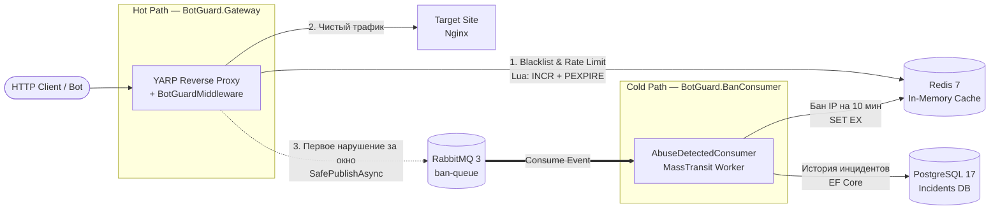

<div align="center">

# BotGuard

**High-Performance Anti-Abuse API Gateway**

[](https://github.com/Bikmacs/BotGuard/actions/workflows/dotnet.yml)

Защита веб-приложений от ботов, парсеров и L7-спама на уровне HTTP-трафика с разделением на синхронный Hot Path и асинхронный Cold Path.

</div>

> [!IMPORTANT]
> ### АРХИТЕКТУРА HOT / COLD PATH И ПРИНЦИП FAIL-OPEN
> Проект спроектирован по принципу **Event-Driven Architecture**. Критический путь проксирования трафика (**Hot Path**) изолирован от тяжелых дисковых операций (**Cold Path**) через брокер сообщений RabbitMQ. Все обращения к внешним хранилищам реализованы по принципу **Fail-Open**: если Redis или RabbitMQ недоступны, шлюз фиксирует сбой в журнале, но продолжает пропускать легитимный трафик на целевой сервер без возврата ошибки `500 Internal Server Error`.

> [!NOTE]
> ### ИНЖЕНЕРНЫЙ КЕЙС: ЛИКВИДАЦИЯ ШТОРМА СОБЫТИЙ (529 RPS → 21 300+ RPS)
> В первой ревизии шлюз публиковал событие `AbuseDetectedEvent` в RabbitMQ на **каждый** заблокированный запрос. При стресс-тесте (500 соединений) это вызвало шторм событий: пропускная способность упала до **529 RPS** (latency 912 ms), а БД получила **32 308 дублирующихся записей**. После внедрения атомарной дедупликации `TryMarkReported` (`SET key value EX 60 NX` в Redis) и отключения публикаций для уже забаненных IP пропускная способность выросла до **21 317 – 39 620 RPS**, а 2.56 млн запросов в комплексном стресс-тесте фиксируют строго **1 запись в БД на каждый уникальный нарушивший IP**.

---

## Архитектура

Система разделена на два независимых контура и разворачивается в изолированной сети из 6 Docker-контейнеров:



1. **Горячий путь (Hot Path — `BotGuard.Gateway`):** Обратный прокси на базе YARP. Извлекает реальный IP клиента (`UseForwardedHeaders`), проверяет заголовок `User-Agent` (с учетом белого списка поисковых роботов `AllowedBots`), проверяет наличие IP в черном списке Redis и контролирует лимит запросов (Fixed Window: 5 запросов за 10 секунд на Lua-скрипте). Чистый запрос проксируется на целевой сервер.
2. **Холодный путь (Cold Path — `BotGuard.BanConsumer`):** Фоновый воркер на базе MassTransit. Слушает очередь `ban-queue` в RabbitMQ, записывает IP-адрес нарушителя в черный список Redis с TTL 10 минут и сохраняет карточку инцидента в PostgreSQL.

---

## Принятые инженерные решения

- **Атомарный Rate Limiting на Lua с самоисцелением TTL:** Выполнение `INCR` и `PEXPIRE` двумя отдельными вызовами из C# создает риск гонки: если процесс шлюза перезапустится между командами, ключ в Redis останется без таймера жизни (`PTTL = -1`), и IP получит вечный бан. Lua-скрипт выполняется в Redis атомарно и проверяет условие `PTTL < 0`, принудительно восстанавливая TTL.
- **Дедупликация событий (`TryMarkReported`):** Пока сообщение о нарушении летит через RabbitMQ в воркер, атакующий бот успевает отправить сотни новых запросов. Маркер `TryMarkReported` (`SET NX EX`) блокирует повторную отправку жалоб на один и тот же IP и тип нарушения в течение 1 минуты, защищая RabbitMQ и PostgreSQL от перегрузки.
- **Белый список поисковых систем (`AllowedBots`):** Перед проверкой черного списка сигнатур (`curl`, `python-requests`, `headlesschrome`, `bot`) инспектор сверяет заголовок с белым списком (`Googlebot`, `YandexBot`, `Bingbot`), чтобы не заблокировать индексацию сайта поисковиками. При этом поисковые боты наравне со всеми проходят проверку Rate Limiter для защиты от спуфинга `User-Agent`.
- **Защита схемы БД и индексация (EF Core):** Поля `IpAddress` и `UserAgent` ограничены на уровне БД (`HasMaxLength(64)` и `HasMaxLength(512)`), что предотвращает атаки на переполнение диска гигантскими заголовками. Для быстрой выборки истории создан составной B-Tree индекс `(IpAddress, DetectedAtUtc)`.
- **Кооперативная отмена (`RequestAborted`):** Токен отмены HTTP-запроса проброшен во все асинхронные операции чтения кэша, публикации событий и записи ответа, а фильтры исключений игнорируют штатный разрыв соединения со стороны клиента (`when (ex is not OperationCanceledException)`).

---

## Технологический стек

- **Платформа:** .NET 10 (C# 14), ASP.NET Core
- **Reverse Proxy:** YARP (Microsoft)
- **Брокер сообщений:** RabbitMQ 3 + MassTransit 8
- **Кэш / Rate Limiter / Blacklist:** Redis 7 (`StackExchange.Redis`, Lua)
- **База данных:** PostgreSQL 17 + Entity Framework Core 10
- **Тестирование и CI:** `xUnit`, `Moq`, GitHub Actions, `wrk` (Lua load scripts)
- **Инфраструктура:** Docker, Docker Compose

---

## Использование (Локальный запуск)

### Требования

- Docker Desktop (или Docker Engine + Compose v2)
- `curl` для базовой проверки

### Запуск стенда

```bash
git clone [https://github.com/Bikmacs/BotGuard.git](https://github.com/Bikmacs/BotGuard.git)
cd BotGuard
docker compose up -d --build
```

Контейнеры баз данных и брокера проверяются через `healthcheck`, миграции PostgreSQL применяются автоматически при старте `banconsumer` (через `MigrateAsync` с циклом retry). Шлюз принимает запросы на `http://localhost:5233`.

### Проверка работы и запуск тестов

```bash
# Запуск модульных тестов (xUnit + Moq)
dotnet test

# 1. Легитимный запрос — проксируется на целевой контейнер Nginx
curl -i -A "Mozilla/5.0 (Windows NT 10.0)" http://localhost:5233/
# → HTTP/1.1 200 OK

# 2. Поисковый бот из белого списка — проходит без бана по User-Agent
curl -i -A "Googlebot/2.1 (+[http://www.google.com/bot.html](http://www.google.com/bot.html))" http://localhost:5233/
# → HTTP/1.1 200 OK

# 3. Подозрительный User-Agent с передачей X-Forwarded-For — блокируется, инцидент пишется в БД
curl -i -H "X-Forwarded-For: 99.88.77.66" -A "python-requests/2.31" http://localhost:5233/
# → HTTP/1.1 403 Forbidden

# 4. Rate limit: 10 запросов подряд — 5 пройдут (200), 6-й → 429, далее бан → 403
for i in {1..10}; do
  curl -s -o /dev/null -w "%{http_code} " \
    -A "Mozilla/5.0 (Windows NT 10.0)" http://localhost:5233/
done; echo
# → 200 200 200 200 200 429 403 403 403 403
```

---

## Результаты нагрузочного тестирования

Тестирование проводилось утилитой `wrk` (16 потоков, 1000 одновременных соединений, Docker Desktop for Mac, Apple Silicon) по четырем профилям атаки.

| Сценарий | Объем трафика | RPS | p50 / p99 Latency | Записей в БД | ban-queue |
| :--- | :--- | :--- | :--- | :--- | :--- |
| **1. До фикса Event Storm** | 500 conn / 30s | 529 | 912 ms / >1.5s | +32 308 (дубли) | переполнена |
| **2. Single IP Flood** (`attack.lua`) | 2.36M reqs (120s) | 19 661 | 44.5 ms / 227 ms | **3 (по 1 в мин)** | **0** |
| **3. Mixed Attack** (`mixed_attack.lua`) | 2.38M reqs (100 IPs) | 39 620 | 18 ms / 586 ms | **100 (1 на IP)** | **0** |
| **4. Ultimate Stress Test** (Смешанный трафик + ботнет) | 2.56M reqs (120s) | 21 317 | 26.8 ms / 152 ms | **1 на каждый IP** | **0** |

**Что доказывают замеры:**
- **Подавление шторма (Сценарии 2, 3, 4):** При прогоне 2.56 млн запросов в комбинированном тесте (легитимный трафик на Nginx + парсеры + флуд с тысяч IP) шлюз удерживает ~21 300 RPS при медиане задержки `26.8 ms`. В таблице `Incidents` создается строго по 1 записи на каждый уникальный заблокированный IP, а очередь `ban-queue` в RabbitMQ разгребается в реальном времени (`messages = 0`).
- **Границы применимости:** При имитации распределенного ботнета, где каждый запрос идет со случайного IP меньше 5 раз за 10 секунд, per-IP лимитер пропускает трафик. Это честная граница применимости прикладного L7-фильтра.

---

## Распространенные вопросы и диагностика

### Ошибка StackExchange.Redis.RedisConnectionException в логах
> **Решение:** Проверьте статус контейнера командой `docker compose ps`. Благодаря паттерну **Fail-Open** и настройке `AbortOnConnectFail = false` шлюз продолжит проксировать трафик и автоматически восстановит связь после запуска Redis.

### Как проверить записанные инциденты в PostgreSQL?
> **Решение:**
> ```bash
> docker compose exec postgres psql -U postgres -d botguard -c 'SELECT "IpAddress", "Reason", COUNT(*) FROM "Incidents" GROUP BY "IpAddress", "Reason" LIMIT 15;'
> ```

### Как разбанить IP вручную?
> **Решение:** Бан истекает автоматически через 10 минут (TTL). Для досрочного удаления ключа выполните:
> ```bash
> # 1. Посмотреть все активные баны
> docker compose exec redis redis-cli --scan --pattern '*list:*'
>
> # 2. Удалить конкретный ключ из вывода выше
> docker compose exec redis redis-cli DEL "blacklist:99.88.77.66"
> ```

---

## Ограничения

`BotGuard` — прикладной L7-фильтр для защиты от скриптов, парсеров и флуд-атак, **не замена** провайдерским сетям уровня Cloudflare или Qrator. Per-IP лимиты не останавливают распределенные ботнеты, где каждый узел делает по 1 запросу с чистого IP. Для такой защиты требуются фильтрация по ASN/GeoIP, JS Proof-of-Work челленджи и очистка трафика на уровне сетевого оборудования (L3/L4 Anycast).

---

## Roadmap

- [x] Проксирование трафика через YARP Reverse Proxy и поддержка `X-Forwarded-For`
- [x] Rate Limiting и Blacklist в Redis на атомарном Lua-скрипте
- [x] Асинхронная шина RabbitMQ + MassTransit и дедупликация Event Storm
- [x] Воркер `BanConsumer` с записью истории в PostgreSQL и авто-миграциями
- [x] Отказоустойчивость Fail-Open и белый список поисковых роботов (`AllowedBots`)
- [x] Оркестрация в Docker Compose и CI-пайплайн в GitHub Actions
- [x] Покрытие сервисов модульными тестами (`xUnit` + `Moq`)
- [x] Нагрузочное тестирование под экстремальной нагрузкой (`wrk`, 2.56M запросов)
- [ ] Двухуровневое кэширование банов (`IMemoryCache` L1 + `Redis` L2)
- [ ] Структурированное логирование (`Serilog` + `Seq`)
- [ ] Admin API и отправка алертов об атаках в Telegram / MAX

---

## ⚖️ Лицензирование

Проект распространяется на условиях лицензии **MIT**.
