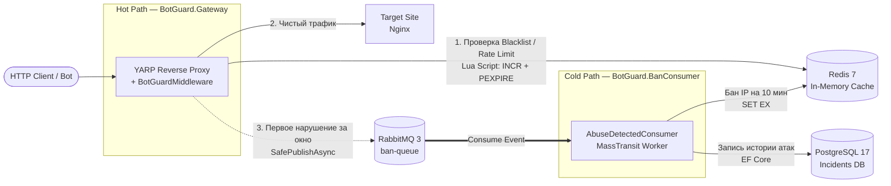

<div align="center">

# BotGuard

**High-Performance Anti-Abuse API Gateway**

Защита веб-приложений от ботов, парсеров и L7-спама на уровне HTTP-трафика с разделением на синхронный Hot Path и асинхронный Cold Path.

</div>

> [!IMPORTANT]
> ### АРХИТЕКТУРА HOT / COLD PATH И ПРИНЦИП FAIL-OPEN
> Шлюз спроектирован по принципу **Event-Driven Architecture**. Критический путь проксирования трафика (**Hot Path**) изолирован от тяжелых дисковых и сетевых операций (**Cold Path**) через брокер сообщений RabbitMQ. Все обращения к инфраструктуре кэширования и очередей обернуты в паттерн **Fail-Open**: при падении Redis или RabbitMQ шлюз логирует сбой, но продолжает пропускать пользовательский трафик на целевой сервер без возврата `500 Internal Server Error`.

> [!TIP]
> ### ИНЖЕНЕРНЫЙ КЕЙС: ЛИКВИДАЦИЯ ШТОРМА СОБЫТИЙ (529 RPS → 20 000+ RPS)
> В первой ревизии шлюз публиковал событие `AbuseDetectedEvent` в RabbitMQ на **каждый** заблокированный запрос. Под нагрузкой в 500 соединений это вызвало шторм событий: пропускная способность упала до **529 RPS** (latency 912 ms, 433 таймаута), а БД получила **32 308 дублирующихся записей**. После внедрения атомарной дедупликации `TryMarkReported` (`SET key value EX 60 NX` в Redis) и отключения публикаций для уже забаненных IP пропускная способность выросла до **20 000–39 620 RPS**, задержка снизилась до **3.4 ms** (p99 < 250 ms), а 1.2 млн запросов от одного нарушителя генерируют ровно **2 целевые записи** в БД.

---

## Архитектурная схема

Система разделена на два независимых контура и разворачивается в изолированной сети из 6 Docker-контейнеров:



1. **Горячий путь (Hot Path — `BotGuard.Gateway`):** Обратный прокси на базе YARP. Извлекает реальный IP клиента (`UseForwardedHeaders`), проверяет `User-Agent` (с учетом белого списка поисковых ботов), проверяет наличие IP в черном списке Redis и валидирует частоту запросов через атомарный Lua-скрипт (Fixed Window: 5 запросов за 10 секунд). Чистый запрос проксируется на целевой сервер.
2. **Холодный путь (Cold Path — `BotGuard.BanConsumer`):** Фоновый воркер на базе MassTransit. Асинхронно вычитывает события из очереди `ban-queue`, помещает IP-адрес нарушителя в черный список Redis с TTL 10 минут и сохраняет карточку инцидента в PostgreSQL.

---

## Принятые архитектурные решения

- **Атомарный Rate Limiting на Lua с самоисцелением TTL:** Выполнение `INCR` и `PEXPIRE` из C# двумя отдельными командами создает риск гонки (Race Condition): если процесс шлюза перезапустится между вызовами, ключ в Redis останется без TTL (`PTTL = -1`), и клиент получит вечный бан. Lua-скрипт выполняется в Redis как единая неделимая команда и дополнительно проверяет условие `PTTL < 0`, восстанавливая таймер жизни ключа.
- **Дедупликация алертов (`TryMarkReported`):** Между моментом превышения лимита в шлюзе и записью бана воркером в Redis проходит несколько миллисекунд. За это время атакующий бот успевает отправить сотни запросов. Механизм дедупликации выставляет в Redis маркер с флагом `When.NotExists` (`SET NX`), гарантируя отправку в RabbitMQ ровно одного события на каждый тип нарушения за окно времени.
- **Защита SEO-трафика (`AllowedBots`) и Zero-Allocation инспекция:** Проверка заголовка `User-Agent` выполняется в памяти без регулярных выражений и лишних аллокаций в куче (`StringComparison.OrdinalIgnoreCase`). Перед проверкой сигнатур парсеров (`curl`, `python-requests`, `headlesschrome`) инспектор сверяет заголовок с белым списком легитимных роботов (`Googlebot`, `YandexBot`, `Bingbot`), предотвращая выпадение защищаемого сайта из поисковой выдачи.
- **Защита и индексация БД (PostgreSQL + EF Core):** Поля `IpAddress` и `UserAgent` ограничены на уровне схемы (`HasMaxLength(64)` и `HasMaxLength(512)`), что защищает диск БД от атак с гигантскими HTTP-заголовками. Для быстрой аналитики инцидентов создан составной B-Tree индекс по полям `(IpAddress, DetectedAtUtc)`.
- **Кооперативная отмена (`RequestAborted`):** Во все асинхронные операции чтения Redis, записи ответа и публикации сообщений проброшен токен `HttpContext.RequestAborted`. При обрыве соединения со стороны клиента шлюз мгновенно освобождает потоки, не засоряя журнал ошибок ложными срабатываниями (`when (ex is not OperationCanceledException)`).

---

## Технологический стек

- **Платформа:** .NET 10 (C# 14), ASP.NET Core
- **Reverse Proxy:** YARP (Yet Another Reverse Proxy)
- **Кэш и Rate Limiting:** Redis 7 (`StackExchange.Redis`, Lua Scripting)
- **Брокер сообщений:** RabbitMQ 3 + MassTransit 8
- **База данных:** PostgreSQL 17 + Entity Framework Core 10 (Npgsql)
- **Инфраструктура и тестирование:** Docker, Docker Compose, `wrk` (Lua load scripts)

---

## Использование (Локальный запуск)

### Требования

- Docker Desktop (или Docker Engine + Docker Compose v2)
- `curl` (и опционально `wrk` для запуска нагрузочных сценариев)

### Запуск стенда

Клонируйте репозиторий и поднимите все 6 контейнеров (`redis`, `rabbitmq`, `postgres`, `target-site`, `banconsumer`, `gateway`) одной командой:

```bash
git clone [https://github.com/Bikmacs/BotGuard.git](https://github.com/Bikmacs/BotGuard.git)
cd BotGuard
docker compose up -d --build
```

Оркестратор дождется готовности инфраструктурных контейнеров (`condition: service_healthy`), воркер `banconsumer` автоматически создаст схему БД через `MigrateAsync()`, а шлюз начнет принимать трафик на порту `http://localhost:5233`.

### Проверка работы

```bash
# 1. Легитимный браузер — успешно проксируется на целевой сайт (Nginx)
curl -i -A "Mozilla/5.0 (Windows NT 10.0)" http://localhost:5233/
# Ожидаемый ответ: HTTP/1.1 200 OK

# 2. Поисковый робот из белого списка — проходит без блокировки
curl -i -A "Mozilla/5.0 (compatible; Googlebot/2.1; +[http://www.google.com/bot.html](http://www.google.com/bot.html))" http://localhost:5233/
# Ожидаемый ответ: HTTP/1.1 200 OK

# 3. Подозрительный скрипт — блокируется в Hot Path, событие уходит в RabbitMQ
curl -i -A "python-requests/2.31" http://localhost:5233/
# Ожидаемый ответ: HTTP/1.1 403 Forbidden

# 4. Проверка Rate Limiter: 5 запросов проходят (200), 6-й превышает лимит (429), далее срабатывает бан (403)
for i in {1..10}; do
  curl -s -o /dev/null -w "%{http_code} " \
    -A "Mozilla/5.0 (Windows NT 10.0)" http://localhost:5233/
done; echo
# Ожидаемый вывод: 200 200 200 200 200 429 403 403 403 403
```

---

## Результаты нагрузочного тестирования

Нагрузочное тестирование проводилось утилитой `wrk` на Apple Silicon (внутри виртуализированной сети Docker Desktop for Mac) с использованием трех Lua-профилей трафика: `attack.lua`, `mixed_attack.lua` и `distributed_attack.lua`.

### 1. Эффект устранения Event Storm (Один атакующий пул, 500–1000 соединений)

| Метрика | До фикса (Event Storm) | После фикса (`TryMarkReported`) |
| :--- | :--- | :--- |
| **RPS (Запросов в сек)** | 529 | **20 000+** |
| **Средняя задержка** | 912 ms | **3.43 ms** |
| **p99 Latency** | > 1 500 ms | **< 250 ms** |
| **Ошибки / Таймауты** | 433 таймаута | **0** |
| **Записей в PostgreSQL** | 32 308 (спам дублями) | **2 (1 UA + 1 RateLimit)** |

### 2. Сравнение профилей атак (Стресс-тест финальной ревизии)

| Сценарий | RPS | p99 Latency | Δ Incidents | ban-queue |
| :--- | :--- | :--- | :--- | :--- |
| **1. Single IP Flood** (`attack.lua`, 927K reqs) | 30 900 | 180 ms | **+1** | **0** |
| **2. Mixed Attack** (`mixed_attack.lua`, 100 IPs, 2.38M reqs) | 39 620 | 586 ms | **+100** | **0** |
| **3. Distributed Botnet** (`distributed_attack.lua`, Random IPs) | 15 835 | 337 ms | 0 | 0 |

**Выводы из замеров:**
- **Подавление шторма (Сценарии 1 и 2):** При атаке с 100 уникальных IP-адресов объемом 2.38 млн запросов шлюз пропустил в очередь ровно 100 событий (по одному на каждый нарушивший IP). Очередь `ban-queue` в RabbitMQ разгребается мгновенно, нагрузка на PostgreSQL снижена на 99.995%.
- **Границы применимости (Сценарий 3):** При имитации распределенного ботнета, где каждый запрос идет с нового случайного IP (`X-Forwarded-For`), счетчик на отдельный IP не превышает порог 5 запросов. Это честная демонстрация границы возможностей классического per-IP лимитера.

---

## Распространенные вопросы и диагностика (FAQ)

### Как посмотреть логи и убедиться, что воркер записывает инциденты?
> **Решение:** Проверьте логи контейнера `banconsumer` и содержимое таблицы `Incidents` в PostgreSQL:
> ```bash
> docker compose logs -f banconsumer
> docker compose exec postgres psql -U postgres -d botguard -c 'SELECT "IpAddress", "Reason", "DetectedAtUtc" FROM "Incidents" ORDER BY "DetectedAtUtc" DESC LIMIT 10;'
> ```

### Как проверить или разбанить IP вручную в Redis?
> **Решение:** Бан автоматически снимается по истечении TTL (10 минут). Для досрочного разбана выполните:
> ```bash
> # 1. Найти все активные ключи блокировки
> docker compose exec redis redis-cli --scan --pattern '*list:*'
>
> # 2. Удалить конкретный ключ (подставьте точное имя ключа из вывода выше)
> docker compose exec redis redis-cli DEL "blacklist:127.0.0.1"
> ```

### Что произойдет, если остановить контейнер Redis или RabbitMQ под нагрузкой?
> **Решение:** Сработает защита **Fail-Open**. Вы можете протестировать это вручную, выполнив `docker compose stop redis rabbitmq`: шлюз запишет ошибку подключения в лог, но продолжит возвращать `200 OK` от целевого сайта Nginx. Как только вы выполните `docker compose start redis rabbitmq`, мультиплексор Redis (`AbortOnConnectFail = false`) и шина MassTransit автоматически восстановят соединение без перезапуска шлюза.

---

## Ограничения и Roadmap

`BotGuard` — легковесный L7-фильтр прикладного уровня для отсечения скриптов, парсеров и одиночных флуд-атак, а не замена провайдерским анти-DDoS сетям (Cloudflare / Akamai / Qrator). Для противодействия крупным распределенным ботнетам (где каждый бот делает 1 запрос со своего IP) требуются репутационные базы ASN/GeoIP, JS Proof-of-Work челленджи и фильтрация на уровне сетевого оборудования (L3/L4 Anycast).

**Выполнено и планируется:**
- [x] Проксирование трафика через YARP Reverse Proxy и поддержка `X-Forwarded-For`
- [x] Распределенный Rate Limiting в Redis на атомарном Lua-скрипте
- [x] Асинхронная шина событий RabbitMQ + MassTransit и дедупликация Event Storm
- [x] Фоновый воркер `BanConsumer` с хранением истории в PostgreSQL и авто-миграциями
- [x] Реализация отказоустойчивости Fail-Open и белого списка поисковых ботов (`AllowedBots`)
- [x] Полная оркестрация стенда в Docker Compose с Healthchecks
- [x] Нагрузочное тестирование (`wrk`, 3 Lua-профиля атаки)
- [ ] Покрытие ядра модульными и интеграционными тестами (`xUnit`, `WebApplicationFactory`)
- [ ] Отправка алертов об открытых инцидентах в Telegram Bot API
- [ ] Honeypot-маршруты (мгновенный бан при обращении к `/.env`, `/wp-login.php`)

---

## ⚖️ Лицензирование

Проект распространяется на условиях лицензии **MIT**.